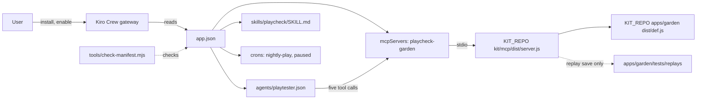

# Design Document

## Overview

`playcheck` is one Kiro Crew app. It has no backend, no UI and no code that runs inside Crew. It is a manifest, one agent file, one skill, and a pointer to the kit's tool door. Crew starts the tool door as a child process over standard input and output. The agent calls its five tools. A small Node checker and its test guard the app files against fields that are not on the Crew pages.

The tool door is the kit's `kit/mcp/dist/server.js`. It takes `--game <folder>` and loads `<folder>/dist/def.js`. It keeps at most 8 sessions in memory. It writes one file only: a replay saved with the `replay` tool.

Sources: the three Crew pages (apps, manifest, build first app) and, in the read only kit repository, `kit/mcp/src/server.ts`, `kit/mcp/src/tools.ts`, `.kiro/settings/mcp.json`, `.kiro/agents/playtester.json` and `docs/tool-door.md`. No command ran when this design was written (the shell tool was refused). Every statement about the kit comes from reading those files, and no number here was checked by running code.

## Architecture



## File layout

```
app.json                          the manifest
agents/playtester.json            the agent, name playcheck-tester
skills/playcheck/SKILL.md         the play rules
tools/check-manifest.mjs          the checker, plain Node
tools/check-manifest.test.mjs     the checker test, node:test
package.json                      scripts only, no dependency
.gitignore                        node_modules
LICENSE                           MIT
README.md                         what, build, install, start messages, transcript, limits
docs/kiro-log.md                  the log
.kiro/steering/                   claims-policy.md, kit-boundary.md, product.md
.kiro/specs/playcheck-crew-app/   requirements.md, design.md, tasks.md, review.md
```

The file names `app.json`, `agents/*.json` and `skills/<name>/SKILL.md` follow the build first app page. The folder `ui/` is not created.

## Components and Interfaces

### `app.json`

Every key below is on the manifest page. `<KIT_REPO>` stays in the committed file as a placeholder.

```json
{
  "name": "playcheck",
  "version": "0.1.0",
  "displayName": "Playcheck",
  "description": "A Crew agent that plays a game built with the kit through its tool door and reports what it saw.",
  "author": "<owner name>",
  "license": "MIT",
  "minKiroCrewVersion": "<version recorded in task 1>",
  "tags": ["testing", "games", "mcp"],
  "agents": ["agents/playtester.json"],
  "skills": ["skills/playcheck"],
  "mcpServers": {
    "playcheck-garden": {
      "command": "node",
      "args": [
        "<KIT_REPO>/kit/mcp/dist/server.js",
        "--game",
        "<KIT_REPO>/apps/garden"
      ]
    }
  },
  "crons": [
    {
      "name": "nightly-play",
      "cron_expr": "0 3 * * *",
      "agent": "playcheck-tester",
      "enabled": false,
      "message": "List the levels with new_game. Play the first three to a won status. For each level report the level id, the seed, the actions sent, the final status and the state hash. Save a replay only for a result that does not match the rules."
    }
  ],
  "dependencies": {
    "commands": ["node"]
  }
}
```

- `author` and `minKiroCrewVersion` are filled by task 1 and task 4. The owner's name is the owner's choice. `minKiroCrewVersion` is the Crew version that task 1 saw, not a guess.
- `mcpServers` has the keys `command` and `args`. The manifest page says entries use `command`, `args`, `url` and `env`. No `env` is needed.
- `permissions` is not in the file. Task 5 adds `permissions.mcpTools` only if Crew refused a tool call without it.
- `platform` is not in the file. The default is macOS and Linux, so an install on Windows may be refused. Task 6 records the result.
- No `ui`, `backend`, `setup`, `contributes` or `heroImage` key. The first version needs none, and the checker rejects them.
- Paths in `agents` and `skills` are relative and stay inside the repository. The `mcpServers` paths are absolute on purpose, and the manifest page says they are not path-checked.
- On Windows the paths in `args` use forward slashes (`C:/work/kit/kit/mcp/dist/server.js`). Node accepts them, and JSON needs no escape.

### `agents/playtester.json`

Fields as on the build first app page.

```json
{
  "name": "playcheck-tester",
  "model": "auto",
  "description": "Plays a game through the kit's tool door and reports what it saw. It never edits a game.",
  "prompt": "<the prompt below, on one line>",
  "tools": ["@playcheck-garden"]
}
```

Prompt text:

> You are a playtester for games that can be played through the tool door of the kit. Use only the game tools new_game, act, observe, render and replay. Do not write or change any game file. If you do not know the level ids, call new_game with no level first. For each level you are asked to play, start it with new_game, read the observation, choose actions only from the legal list, and stop when the status phase is won or lost. Report the level, the seed, the actions you sent, the final status and the state hash. If the result does not match the rules you were given, call replay with the session and save true, and give the file name from the answer. That saved replay is the only file a run may write. It goes in the game folder under tests/replays. Never say a level is fine unless you played it to a won status in this session.

Differences from the kit's own `.kiro/agents/playtester.json`, which is not copied:
- Its `tools` entry `read`, `includeMcpJson`, `allowedTools`, `permissions` and `kiroUpgrade` are not on the Crew pages. They are dropped. Without `read` the agent cannot open the game's rule files, so the prompt says "the rules you were given".
- It has no `model`. This one has `model` `auto`, as the Crew page shows.
- The kit prompt says "Do not write or change any file" and also asks for a saved replay. The saved replay is a file write (`tools.ts`, the `replay` handler). The new prompt says so.
- The tool names `@garden`, `@runner` and `@sample` are the server names of the kit's own `mcp.json`. In Crew the server is `playcheck-garden`. How an agent names it is open until task 5.

### `skills/playcheck/SKILL.md`

Front matter, as on the build first app page:

```
---
name: playcheck
description: How to play a game through the five kit tools and report what happened.
triggers: [playcheck, playtest, new_game, play a level]
always: false
---
```

Body, in this order, each a short section:

1. **The five tools.** One line each with its input, from `docs/tool-door.md`: `new_game` (`level`, optional `seed` 0 to 2147483647, default 1; with no level it lists `game`, `kind` and `levels`), `act` (`session`, `actions`), `observe` (`session`), `render` (`session`, `format` required, `"text"` or `"svg"`), `replay` (`session` and optional `save`, or `replay`; not both).
2. **Starting.** List the levels first. Start a level. Read `observation.summary`, `textMap`, `legend` and `legal`.
3. **Actions.** Copy action texts from `legal`. Never invent one. `text*n` repeats one action n times, n from 2 to 3600. At most 600 items and 3600 actions in one call. The call stops at the first refused action and names the reason in `stoppedBy`: `bad_action_text`, `illegal_action` or `game_over`. `applied` says how many went through.
4. **Games that run on ticks.** When `new_game` says `kind` is `tick`, send short runs such as `none*5` and call `observe` between them. A long run cannot be undone. A level that is lost needs a new session.
5. **Errors.** An error answer has `error` and `message`. The codes are `unknown_session`, `unknown_level`, `bad_seed`, `too_many_actions`, `bad_input` and `internal_error`. Eight sessions at most stay open, and the oldest unused one can be dropped, which gives `unknown_session`.
6. **Report.** One block for each level: level, seed, actions, final status, hash. Then one line: `matches the rules` or `does not match the rules because ...`.
7. **Saving a replay.** Only for a result that does not match the rules. `replay` with `session` and `save` true writes a file in the game folder. Give the file name.
8. **Never.** Never say a level is fine unless it reached `won` in this session. Never name a game's action text from memory.

The skill names no word from any one game (requirement 5.3). The eight sessions limit is from the kit's design (`tool-door-and-prover`). It is not in `server.ts`, and the skill step 5 is to be confirmed against `kit/mcp/src/store.ts` in task 4 before the text is written.

### `tools/check-manifest.mjs`

Plain Node 20, ES module, no dependency. Imports only `node:fs`, `node:path` and `node:url`.

```js
export const ALLOWED = {
  manifest: ['name', 'version', 'displayName', 'description', 'author', 'license',
    'minKiroCrewVersion', 'tags', 'agents', 'skills', 'mcpServers', 'crons', 'dependencies'],
  agent: ['name', 'model', 'description', 'prompt', 'tools'],
  cron: ['name', 'every', 'cron_expr', 'message', 'agent', 'enabled'],
  server: ['command', 'args', 'url', 'env'],
  dependencies: ['commands', 'optionalCommands'],
  frontMatter: ['name', 'description', 'triggers', 'always'],
};
// task 5 adds 'permissions' to manifest and a 'permissions' entry { mcpTools } only if Crew needed it.

/** @returns {{ file: string, rule: string, message: string }[]} */
export function checkRepo(root, options = {}) {}
```

`options.strict` is a boolean. The command line is `node tools/check-manifest.mjs [--strict] [root]`. It prints one line `file: rule: message` for each problem and exits 1 when there is any, else prints `ok` and exits 0. The default root is the repository root (the folder above `tools/`).

Rules and their names:

| Rule | Checks |
| --- | --- |
| `json` | `app.json` and each agent file parse as JSON |
| `allowed-keys` | each key of the manifest, an agent file, a `crons` entry, a `mcpServers` entry and `dependencies` is on its list in `ALLOWED` |
| `required-fields` | `name`, `version`, `displayName`, `description` are non-empty strings in the manifest; `name`, `model`, `description`, `prompt` are non-empty strings and `tools` is a non-empty list in the agent file |
| `name` | `name` matches `/^[a-z0-9]+(?:-[a-z0-9]+)*$/` |
| `semver` | `version` matches `^\d+\.\d+\.\d+$` |
| `version-below-1` | the first number of `version` is 0 |
| `path-inside` | each path in `agents` and `skills` is relative, has no `..` part, and resolves inside the root |
| `path-exists` | each path in `agents` is a file and each path in `skills` is a folder with a `SKILL.md` |
| `cron-schedule` | each cron has `name`, a non-empty `message`, and exactly one of `every` (a positive number) and `cron_expr` (a non-empty text) |
| `cron-enabled-boolean` | `enabled`, when present, is a JSON boolean |
| `cron-ships-off` | `enabled` is present and `false` |
| `door-args` | each `mcpServers` entry has `command` as text and `args` as a list of text; if `args` holds `--game`, a value follows it and the value does not start with `--` |
| `dependencies` | `dependencies.commands` holds `node` |
| `skill-front-matter` | `SKILL.md` starts with a line `---`, has `name`, `description`, `triggers` and `always`, no other key, `name` equals the folder name, and `always` is `false` or `true` |
| `encoding` | no checked text file starts with a byte order mark or holds a carriage return |
| `secret` | no text file outside `.git` and `node_modules` matches `ghp_[A-Za-z0-9]{36}`, `AKIA[0-9A-Z]{16}`, `sk-[A-Za-z0-9]{20,}`, `-----BEGIN [A-Z ]*PRIVATE KEY-----`, a Windows user folder `[A-Za-z]:[\\/]Users[\\/]`, or a Unix home `/Users/` or `/home/` followed by a name |
| `placeholder` | only with `strict`: `app.json` does not hold `<KIT_REPO>` |

The checker reads files only. It writes nothing and runs no command.

Text files for `encoding` and `secret`: every file under the root except `.git/` and `node_modules/`, read as UTF-8, with a skip for files that hold a zero byte.

### `package.json`

```json
{
  "name": "playcheck-crew-app",
  "version": "0.1.0",
  "private": true,
  "license": "MIT",
  "type": "module",
  "scripts": {
    "test": "node --test tools/check-manifest.test.mjs",
    "check": "node tools/check-manifest.mjs",
    "verify": "npm test && npm run check"
  }
}
```

No dependency. The test file is named in the script because Node versions differ in how `node --test` takes a folder.

### `README.md`

Sections in order: what the app does (three sentences); what you need (Kiro Crew running, Node 20 or newer, the kit repository); build the tool door (`npm run build:kit`, `npm run build:apps` in `<KIT_REPO>`); set the path (replace `<KIT_REPO>` in `app.json` in a copy or in the folder, then `node tools/check-manifest.mjs --strict`); install and enable (the `curl.exe` commands for Windows PowerShell and the dashboard route, with the install and enable URLs from the Crew pages); play (an example request); the nightly job (off, uses your own Kiro credits, how to switch on as seen in task 7); the five start messages with a fix each; one real transcript or the line "no run was made"; limits (garden puzzle only; the runner entry is not shipped because the kit has no built runner; a saved replay is written into the game folder; the pages do not say how Crew fills variables, so paths are written in by hand); licence.

### `LICENSE`

The MIT text, year and owner name left for the owner to fill. It is the only file with a placeholder that task 4 does not resolve, and the log says so.

### `docs/kiro-log.md`

The file exists with the kit's four sections: the task table, "Hooks seen to fire", "Tool door transcripts", "Dependencies and licences". Rows follow the column order of the table header. The Credits cell stays empty.

## Data Models

Tool door answers the agent reads, from `kit/mcp/src/tools.ts`:

| Tool | Success answer keys |
| --- | --- |
| `new_game`, no level | `game`, `kind`, `levels` |
| `new_game`, level | `session`, `level`, `seed`, `tick`, `status`, `observation`, `legal` |
| `act` | `applied`, `stoppedBy`, `tick`, `status`, `observation`, `legal`, `hash` |
| `observe` | `tick`, `status`, `observation`, `legal`, `hash` |
| `render` | text (a summary, a map and a legend) or SVG text |
| `replay`, session | `replay`, and `file` when `save` is true |
| `replay`, object | `ok`, `finalHash`, `finalPhase` (from `docs/tool-door.md`; the exact keys of `runReplay` were not read) |

An error answer has `isError` true and the text `{"error":"<code>","message":"<text>"}`.

## Error Handling

Start failures of the tool door. Each is one line on standard error that starts with `kit-mcp: `, then exit code 1. Lines are from `server.ts`: the `stop` function, `gameFolderFromArguments`, `loadDefinition` and the final `.catch` of `main()`.

| Cause | Message | Fix |
| --- | --- | --- |
| `--game` is missing or has no value | `the --game argument is missing. Use: node server.js --game <game folder>` | Put the game folder after `--game` in `args` |
| The game was not built, or the path is wrong | `cannot load <folder>/dist/def.js: <first line of the Node error>` | Run `npm run build:apps` in `<KIT_REPO>`, and check the path |
| The file has no default export | `<folder>/dist/def.js has no default export` | Rebuild the game |
| The definition fails `validateDef` | `<folder>/dist/def.js is not a valid game definition: <problems>` | Fix the game in the kit repository |
| Anything else while starting | `unexpected failure: <text>` | Read the text |

- A relative `--game` path is resolved against the process folder (`resolve(process.cwd(), value)`). Crew's folder for the child process is not on the pages, so the manifest uses absolute paths.
- If the server file itself is missing, `node` prints its own `Cannot find module` message and exits, with no `kit-mcp: ` prefix. The README lists this as a sixth case with the same fix as the second.
- Whether Crew shows standard error of an MCP server is not on the pages. Task 5 starts the server by hand once, and the README says what was seen.
- Tool errors: the codes of `tools.ts`. The agent reports an error answer in its report and goes on with the next level.
- A session that was dropped gives `unknown_session`. The agent starts the level again with `new_game`.
- Install errors: Crew rejects a bad name, a bad version, a path that leaves the app root, and a cron with neither `every` nor `cron_expr` (manifest page, install rules). The checker finds the same four before install. A refusal because of `platform.os` or `minKiroCrewVersion` is written in the log as seen. It is not worked around.
- The checker: a file that cannot be read gives a problem with rule `json` or `path-exists` and does not stop the other checks.

## Testing Strategy

Every case below is written first in `tools/check-manifest.test.mjs` and seen to fail, because `tools/check-manifest.mjs` does not exist (task 2). The log row of task 2 gives the count of failing cases. The test uses `node:test` and `node:assert/strict`. It builds a valid repository in a temporary folder with a helper `makeRepo(edit)`, which writes the files from the shapes above, applies `edit` to the parsed objects, and returns the folder. It removes the folder after each case. It never writes in the real repository.

| Case | Edit | Expected |
| --- | --- | --- |
| valid | none | no problem |
| valid, strict off, placeholder in `args` | none | no problem |
| strict | none, `strict` true | one problem, rule `placeholder` |
| bad JSON | `app.json` is `{` | rule `json` |
| name | `name` is `Play_Check` | rule `name` |
| semver | `version` is `0.1` | rule `semver` |
| version 1 | `version` is `1.0.0` | rule `version-below-1` |
| empty field | `description` is `""` | rule `required-fields` |
| extra manifest key | `repo` added | rule `allowed-keys`, message names `repo` |
| extra agent key | `includeMcpJson` added to the agent | rule `allowed-keys` |
| extra server key | `autoApprove` added to the server | rule `allowed-keys` |
| extra cron key | `schedule` added | rule `allowed-keys` |
| missing agent field | `model` removed | rule `required-fields` |
| path up | `agents` is `["../x.json"]` | rule `path-inside` |
| path absolute | `agents` is an absolute path | rule `path-inside` |
| path missing | `agents` names a file that does not exist | rule `path-exists` |
| skill folder without file | `SKILL.md` removed | rule `path-exists` |
| cron both | `every` and `cron_expr` | rule `cron-schedule` |
| cron neither | both removed | rule `cron-schedule` |
| cron string | `enabled` is `"false"` | rule `cron-enabled-boolean` |
| cron on | `enabled` is `true` | rule `cron-ships-off` |
| cron missing | `enabled` removed | rule `cron-ships-off` |
| door value | `args` ends with `--game` | rule `door-args` |
| door next flag | `args` holds `--game`, `--x` | rule `door-args` |
| dependency | `commands` is `[]` | rule `dependencies` |
| skill no front matter | file starts with text | rule `skill-front-matter` |
| skill missing key | `triggers` removed | rule `skill-front-matter` |
| skill name | `name` differs from the folder | rule `skill-front-matter` |
| BOM | `app.json` starts with U+FEFF | rule `encoding` |
| CRLF | `SKILL.md` holds `\r\n` | rule `encoding` |
| token | a file holds `ghp_` plus 36 letters, joined in the test from two parts | rule `secret` |
| owner folder | a file holds a Windows user folder path, joined from two parts | rule `secret` |
| command line, valid | run the script with the temporary folder | exit 0, output `ok` |
| command line, bad | one edit from above | exit 1, output holds the file and the rule |
| command line, strict | `--strict` | exit 1, output holds `placeholder` |

Case count: 35. The `valid` case has a README that holds `<KIT_REPO>`, so it also shows that the placeholder is a problem only in `app.json` and only with `strict`.

Checks that are not unit tests, each recorded in the log by the task that makes it, and written as not run when not made:
- Task 1: Crew starts and the dashboard opens. The name search in Discover. The `platform.os` default read from the page.
- Task 5: the agent lists the five tools; the value of `tools` that works; the hand start of the tool door with a bad path.
- Task 6: install and enable in Crew; one level played to `won`; the `replay` tool run on the agent's own replay object without `save`.
- Task 7: the job is shown as paused.

These need a running Crew and cannot be unit tests. A check that did not run is not claimed.

## Correctness Properties

1. **No unlisted field.** For any manifest, agent file, cron entry or server entry with a key outside `ALLOWED`, `checkRepo` reports `allowed-keys`. (Requirements 6.2, and the rule "no field that is not on the pages")
2. **The job ships off.** For any `app.json` whose cron has `enabled` other than `false`, `checkRepo` reports a problem. (4.1)
3. **The checker is read only.** `checkRepo` leaves every byte of the folder it reads unchanged. (6.1)
4. **Strict finds the placeholder.** `checkRepo` with `strict` reports `placeholder` exactly when `app.json` holds `<KIT_REPO>`. (3.2)

## Decisions and Alternatives

- Absolute paths in `args` over an environment variable. The kit's server reads only `--game` (`server.ts`, `gameFolderFromArguments`), and the pages do not say Crew fills variables in `args`. The other option is a wrapper script that reads a variable and starts the server. That adds app code and relies on how Crew builds the child's environment, which the pages do not say. Chosen: absolute paths, edited by hand, checked by `--strict`.
- One tool door entry over two. The kit has no built runner, so a second entry stops on start. The cost: the runner is not covered. It is added when the kit has `apps/runner/dist/def.js`.
- No `permissions` block over a guessed one. The pages show `permissions.mcpTools` as a list of allowed tool names, but not whether tool calls need it. Task 5 finds out.
- The checker is plain Node over a JSON schema library. It adds no dependency and no licence row.
- A cron message without the prover. The agent has no shell tool, and `prove` is a kit command that writes in the kit's `proofs/` folder.

## Out of Scope

- A dashboard page, a backend, side panel tabs, command bar rows, file actions or session controls.
- A runner entry, and any game other than the garden puzzle.
- Publishing the app to the registry. The publishing page was not read for this spec.
- Changing anything in the kit repository, including its stray text in `docs/tool-door.md` and its log (see `review.md`).
