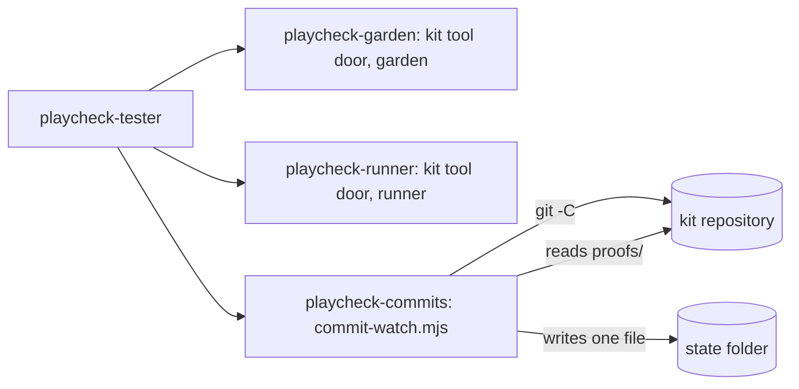

# Design Document

## Overview

Three tool servers sit behind one agent. Two are the kit's tool door, started once for each game. The third is `tools/commit-watch.mjs`, which belongs to this app.



The nightly flow: `kit_commit` says whether the kit has a commit the app has not checked. If not, the job reports and stops, and costs almost nothing. If so, the agent asks `kit_proof` for each proof replay, runs it with the replay tool of the right game, and compares the final hash with the proof. Then it plays two levels by hand, and `mark_checked` stores the hash.

## `app.json` changes

```json
"mcpServers": {
  "playcheck-garden":  { "command": "node", "args": ["<KIT_REPO>/kit/mcp/dist/server.js", "--game", "<KIT_REPO>/apps/garden"] },
  "playcheck-runner":  { "command": "node", "args": ["<KIT_REPO>/kit/mcp/dist/server.js", "--game", "<KIT_REPO>/apps/runner"] },
  "playcheck-commits": { "command": "node", "args": ["<APP_DIR>/tools/commit-watch.mjs", "<KIT_REPO>"] }
}
```

Only `command` and `args`. `version` goes to `0.2.0` (still below 1.0). The cron keeps `enabled` false.

## Checker changes (`tools/check-manifest.mjs`)

- New rule `agent-tools`: for each agent file, the entries `@<app name>:<server>` must name a key of `mcpServers`, and every key of `mcpServers` must appear. Other entry forms are not judged.
- Rule `placeholder` (strict): reports once, and names `<KIT_REPO>` and `<APP_DIR>` when present.
- The test fixture agent changes from `@playcheck-garden` to `@playcheck:playcheck-garden`, the form the first spec recorded as working. No case is weakened.

## `tools/commit-watch.mjs`

Imports `node:child_process` (`execFileSync`, only with the program `git`, no shell), `node:fs`, `node:os`, `node:path`, `node:readline`. No package.

Protocol: one JSON object per input line. A line that is not JSON gives `-32700` with id null. A request has an `id`; a notification does not and gets no answer.

| Method | Answer |
| --- | --- |
| `initialize` | `protocolVersion` (the client's if it is `2025-06-18`, `2025-03-26` or `2024-11-05`, else `2025-06-18`), `capabilities {tools:{}}`, `serverInfo {name:"commit-watch", version:"0.1.0"}` |
| `ping` | `{}` |
| `tools/list` | the three tools with `name`, `description`, `inputSchema` |
| `tools/call` | `{content:[{type:"text", text:<JSON text>}]}`, with `isError:true` on failure. An unknown tool name gives error `-32602` |
| other | error `-32601` |

Tools:

| Tool | Input | Answer |
| --- | --- | --- |
| `kit_commit` | none | `{hash, subject, stored, changed}` |
| `kit_proof` | `game`, optional `level` | `{game, level, replay}` or `{game, levels}` |
| `mark_checked` | `hash` (40 to 64 hex characters), `result` (text, 1 to 2000 characters) | `{ok:true, stored, file}` |

State file `playcheck-commit-state.json`: `{"hash": "...", "result": "...", "checkedAt": "<ISO time>"}`. The state folder is created if it is missing. A state file that is not valid JSON counts as no stored hash.

Names: `/^[A-Za-z0-9-]+$/` for `game` and `level`. The proof file is `<kit>/proofs/<game>/<level>.json`; the level `index` is refused because that file holds the list. Level ids are the `*.json` files of the game folder without `index`, sorted.

## Skill and agent

The skill gets a section for the three servers and the report, and its tick section names the runner levels `r01` to `r06`, the legal actions `none` and `jump`, the first actions of each proof, and the first hand play recorded in the kit log. It tells the agent that the garden and the runner each have `new_game`, so a level of the other game gives `unknown_level`. The kit's own log saw tool names that collide on one engine; that has not been tried in Crew.

## Not decided here

Whether Crew keeps tools of two servers with the same names apart is not seen. The README says so under Limits.

## State folder (task 5)

`playcheck-commits` args become `["<APP_DIR>/tools/commit-watch.mjs", "<KIT_REPO>", "--state", "<APP_DIR>/data"]`. The checker has the rule `state-arg`: the entry needs `--state` with a folder after it. In strict mode the folder must equal the script folder with `tools/commit-watch.mjs` replaced by `data`. The server is unchanged: its fallback to `KIROCREW_APP_DATA` and the temp folder stays for a bare run. Version `0.2.1`.

## README from the runs (task 6)

The three sections are rewritten from the facts of 2026-11-20. Run 2 is quoted from `docs/crew-runs-2026-11-20.md`, and a checker test compares the quoted block with that file.

## Dashboard route (task 7)

The README section "Dashboard, 2026-11-20" lists the facts of the dashboard install in the order they were seen. A checker test reads the real README. It fails when the old sentence is back, or when `Install from Path`, `Manage app sources`, the dialog title, the button text or `playcheck 0.2.1 disabled` is missing.

## First runs of 0.2.1 (task 8)

Three README cases read the real README and the runs file. They fail when the sentences "not yet run on Crew", "has not run on Crew" or "installed and switched off" are present, when a sentence says the agent won by hand, or when the data folder path, the hash of the kit commit, the answer `No new commit`, the agent's sentence about the proof's action lists or the limits line is missing. The README quotes run 5 whole and the hand play table and closing text of run 4.